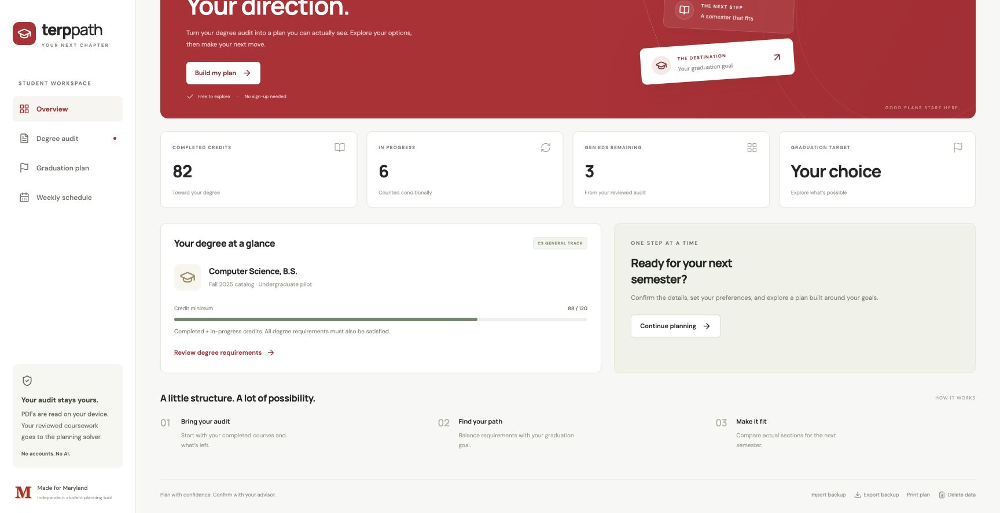

# Terp Path

An unofficial UMD degree and schedule planner. A React/TypeScript frontend reads a uAchieve PDF locally; a stateless FastAPI/OR-Tools service searches graduation plans and compatible Testudo sections. No AI or accounts.



## Run locally

Use Node 22+ and Python 3.13. No API keys are required.

```sh
npm ci
python3.13 -m venv .venv
.venv/bin/pip install -r server/requirements.lock
.venv/bin/uvicorn server.app.main:app --reload --port 8011
# In another terminal:
npm run dev
```

Open **http://127.0.0.1:5173**. Use the same host consistently: `localhost` and `127.0.0.1` have separate browser storage. API documentation is at http://127.0.0.1:8011/docs.

Upload an **expanded, printer-friendly uAchieve PDF**, review the extracted profile and Gen Ed counts, confirm the review checkbox, and generate a plan. A synthetic example is available from the overview. The first live request can take about a minute while public UMD pages are cached.

For a single-process local preview, build before starting the API:

```sh
npm run build
.venv/bin/uvicorn server.app.main:app --host 127.0.0.1 --port 8011
```

Open http://127.0.0.1:8011. The API serves `dist/` and supports the frontend's `/api` prefix. This is a local pilot, not a hardened public deployment.

## Capabilities

- Browser PDF extraction, deduplicated course attempts, transfer/AP and in-progress credits, credit reconciliation, and editable import review.
- CS area/elective allocation, prerequisite sequencing, concentration overlap/exclusions, residency/credit minimums, graduation targets, and semester credit limits.
- Gen Ed discovery, interests, course pins/exclusions, course moves with academic revalidation, and section pins.
- Linked lecture/lab/discussion meetings, blocked times, open-seat filters, and alternative weekly calendars.
- IndexedDB saves, validated JSON backups including draft plans, printable views, and data deletion. Restored plans must be regenerated before use.

## Pilot boundaries

Only **program 07010, CS general track, Fall 2025 catalog** is accepted for planning. The audit does not identify every specialization reliably; students must confirm their track. No minor or second-major validation yet.

Plans remain **conditional**. In-progress grades, cumulative/major/concentration GPA at graduation, advisor approvals, natural-language restrictions, TBA meetings, and future offerings cannot be guaranteed. The prerequisite parser enforces recognized conjunctions and alternatives and preserves unrecognized language as conditions. Student notes do not waive solver constraints.

The rule pack supports the standard CS courses in the supplied audit. Special topics, STICs, variable-credit choices, additional math substitutions, historical exceptions, and complete graduation-clearance policy need advisor review. Gen Ed remaining counts come from the reviewed audit, including in-progress allocations; this is not a replacement for uAchieve's full allocation engine.

Concentration allocation enforces the major-course exclusion, CMSC cross-list exclusions, professional-writing exclusion for English, at most six transfer credits, and at most three independent/experiential credits. Concentration eligibility and GPA still need approval. The catalog covers CMSC, MATH, STAT, ENGL, HIST, ECON, the chosen concentration, and pinned departments, bounded to eight departments per request.

The start term uses published offerings. Historical courses and official-catalog-only courses can support later **unknown projections**, not predictions of seats or future schedules. Seats can change immediately after retrieval. Unknown seats are excluded unless full/unknown sections are enabled. Exact travel time between buildings is not modeled.

Search is bounded. Results distinguish review needs, conditional candidates, infeasibility within the loaded candidates/horizon, and timeout. A candidate found before optimization finishes explicitly does not prove earliest graduation or preference optimality. Active semesters honor the configured minimum; reducing it can allow a lighter final semester.

## Data and privacy

Original PDFs never leave the browser or enter IndexedDB. Stored profiles omit names, student IDs, and raw audit text. Reviewed coursework and preferences go to the local solver; student data is not persisted or logged by the backend. JSON exports contain academic data, so keep them private.

Public data comes from [Testudo](https://app.testudo.umd.edu/soc/), the [UMD catalog](https://academiccatalog.umd.edu/undergraduate/approved-courses/), and [CS department rules](https://undergrad.cs.umd.edu/degree-requirements-cs-major). Offerings/catalog pages cache for 24 hours, sections for five minutes, with stale-cache warnings on failure. Two preceding regular terms provide historical candidates. `UMD_CACHE_PATH` overrides the default `/tmp/umd-planner-cache.sqlite` public-data cache.

No private audit, extracted student record, local database, or secrets belong in Git. Tests use synthetic fixtures. The supplied real audit was checked locally without committing its contents.

## Checks

```sh
.venv/bin/pip install -r server/requirements-dev.txt
npm test
npm run build
npm run format:check
.venv/bin/python -m pytest server/tests
.venv/bin/ruff check server
.venv/bin/ruff format --check server
```

GitHub Actions runs these checks on pushes and pull requests. Tests cover import/deduplication, plus/minus grades, credit mismatches, backup validation, deadlines, prerequisites, requirement overlap, concentration transfer limits, linked meetings, seat filters, day parsing, blocked times, catalog markup, and connected API behavior.

See [implementation notes](docs/ARCHITECTURE.md) and [milestones](docs/MILESTONES.md). Expand program coverage only after validating more consented, redacted audits against manually reviewed outcomes. Instructor ratings and workload signals remain future additions.
