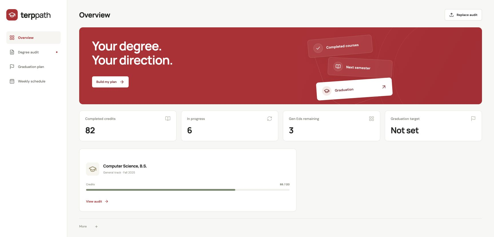

# Terp Path

An unofficial UMD degree and schedule planner. A React/TypeScript frontend reads a uAchieve PDF locally; a stateless FastAPI/OR-Tools service searches graduation plans and compatible Testudo sections. No AI or accounts.



## Run locally

Use Node 22+ and Python 3.13. No API keys are required.

```sh
npm ci
python3.13 -m venv .venv
.venv/bin/pip install -r server/requirements.lock
npm run dev
```

`npm run dev` starts the planning API and frontend together, waits for API readiness, and stops both when you press Ctrl+C. If the API is already running, it reuses it. For separate terminals, use `npm run dev:web` and `.venv/bin/uvicorn server.app.main:app --reload --port 8011`.

Open **http://127.0.0.1:5173**. Use the same host consistently: `localhost` and `127.0.0.1` have separate browser storage. API documentation is at http://127.0.0.1:8011/docs.

Upload an **expanded, printer-friendly uAchieve PDF**, review the extracted profile and Gen Ed counts, confirm the review checkbox, and generate a plan. A synthetic example is available from the overview. The first live request can take about a minute while public UMD pages are cached.

For a single-process local preview, build before starting the API:

```sh
npm run build
.venv/bin/uvicorn server.app.main:app --host 127.0.0.1 --port 8011
```

Open http://127.0.0.1:8011. The API serves `dist/` and supports the frontend's `/api` prefix. This is a local pilot, not a hardened public deployment.

## Capabilities

- Browser PDF extraction, deduplicated course attempts, transfer/AP and in-progress credits, credit reconciliation, and editable import review.
- CS area/elective allocation, prerequisite sequencing, concentration overlap/exclusions, residency/credit minimums, graduation targets, and semester credit limits.
- **Graduate in** uses the selected semester as the final enrolled term, with fall/spring enrollment through that date. Credit minimums can add courses to fill the timeline. **Earliest available** finds the earliest feasible finish. An explicitly selected summer/winter start or graduation term is included; other summer/winter terms remain optional.
- Semester balance spreads upper-level technical courses, concentration courses, credit loads, and course counts across enrolled terms. It also favors fewer course commitments over filling a credit target with many one-credit classes. These are structural workload proxies; GPA and reviews are not difficulty scores.
- Optional online/async preference for published first-semester courses and sections. Balanced semesters take priority over delivery format; within equally balanced plans, async sections rank ahead of other online sections, then blended sections. Graduation timing, total credits, seat rules, pins, prerequisites, and conflicts retain priority.
- Gen Ed discovery, interests, course pins/exclusions, course moves with academic revalidation, and section pins.
- Joint course-and-section search with linked lecture/lab/discussion meetings, blocked times, open-seat filters, and alternative weekly calendars.
- IndexedDB saves, validated JSON backups including draft plans, printable views, and data deletion. Restored plans must be regenerated before use.
- Professor ratings and review links, course and instructor-specific historical GPAs, and expandable grade distributions from PlanetTerp.
- A schedule comparison table sortable by ratings, GPA, campus days, or gaps, plus course/section comparisons with pinning for regeneration.

## Pilot boundaries

Only **program 07010, CS general track, Fall 2025 catalog** is accepted for planning. The audit does not identify every specialization reliably; students must confirm their track. No minor or second-major validation yet.

Plans remain **conditional**. In-progress grades, cumulative/major/concentration GPA at graduation, advisor approvals, natural-language restrictions, TBA meetings, and future offerings cannot be guaranteed. The prerequisite parser enforces recognized conjunctions and alternatives and preserves unrecognized language as conditions. Student notes do not waive solver constraints.

The rule pack supports the standard CS courses in the supplied audit. Special topics, STICs, variable-credit choices, additional math substitutions, historical exceptions, and complete graduation-clearance policy need advisor review. Gen Ed remaining counts come from the reviewed audit, including in-progress allocations; this is not a replacement for uAchieve's full allocation engine.

The concentration dropdown includes 47 choices with subject names and codes. Changing the concentration refreshes the course browser's department selection. General Business loads both BMIN and BMGT courses, includes the minor's approved BMGT substitutes, and recognizes former course numbers in searches and completed coursework. Equivalent courses cannot supply duplicate credit. This selection plans the CS upper-level concentration; it does not validate completion of the full 15-credit business minor.

Concentration allocation enforces the major-course exclusion, CMSC cross-list exclusions, professional-writing exclusion for English, at most six transfer credits, and at most three independent/experiential credits. It also excludes the ineligible courses listed on [UMD's ULC page](https://undergrad.cs.umd.edu/upper-level-concentration), checked November 1, 2026. Letter-suffixed upper-level courses can count when otherwise eligible. Advisor exceptions and other mixed-department minors are not inferred. Concentration eligibility and GPA still need approval. Catalog requests prioritize core subjects, the chosen concentration's departments, and pinned departments within an eight-department budget; HIST and ECON provide additional Gen Ed options when space permits.

The start term uses published offerings. Historical courses and official-catalog-only courses can support later **unknown projections**, not predictions of seats or future schedules. Seats can change immediately after retrieval. Unknown seats are excluded unless full/unknown sections are enabled. Exact travel time between buildings is not modeled.

Search is bounded. Results distinguish review needs, conditional candidates, infeasibility within the loaded candidates/horizon, and timeout. A candidate found before optimization finishes explicitly does not prove earliest graduation or preference optimality. Active semesters honor the configured minimum; reducing it can allow a lighter final semester.

## Data and privacy

Original PDFs never leave the browser or enter IndexedDB. Stored profiles omit names, student IDs, and raw audit text. Reviewed coursework and preferences go to the local solver; student data is not persisted or logged by the backend. JSON exports contain academic data, so keep them private.

Public data comes from [Testudo](https://app.testudo.umd.edu/soc/), the [UMD catalog](https://academiccatalog.umd.edu/undergraduate/approved-courses/), and [CS department rules](https://undergrad.cs.umd.edu/degree-requirements-cs-major). Offerings/catalog pages cache for 24 hours, sections for five minutes, with stale-cache warnings on failure. Sections are fetched in bounded multi-course batches. Known missing seats or conflicts constrain next-semester course choices directly; failed section downloads remain unverified. Two preceding regular terms provide historical candidates. `UMD_CACHE_PATH` overrides the default `/tmp/umd-planner-cache.sqlite` public-data cache.

No private audit, extracted student record, local database, or secrets belong in Git. Tests use synthetic fixtures. The supplied real audit was checked locally without committing its contents.

## Checks

```sh
.venv/bin/pip install -r server/requirements-dev.txt
npm test
npm run build
npm run format:check
.venv/bin/python -m pytest server/tests
.venv/bin/ruff check server
.venv/bin/ruff format --check server
```

GitHub Actions runs these checks on pushes and pull requests. Tests cover import/deduplication, plus/minus grades, credit mismatches, backup validation, exact graduation semesters, prerequisites, requirement overlap, concentration transfer limits, linked meetings, seat filters, day parsing, blocked times, catalog markup, and connected API behavior.

See [implementation notes](docs/ARCHITECTURE.md) and [milestones](docs/MILESTONES.md). Expand program coverage only after validating more consented, redacted audits against manually reviewed outcomes. Workload estimates remain a future addition; ratings and grade history are not treated as workload measurements.

## Course and professor comparisons

Click a course or **Sections** to compare current sections, GPA, and professor ratings. **Reviews** opens the professor's PlanetTerp page; grade distributions are available in an expandable panel. Pin an eligible section and regenerate to apply it. Open **Compare schedules** on the weekly schedule page to compare generated options. Comparisons reorder existing valid options and never change academic constraints.

Public data comes from the [PlanetTerp API](https://docs.planetterp.com/). Only course identifiers and instructor names are sent to PlanetTerp. Lookups run separately from generation, serialize external requests with a pause, cache successful results for 24 hours and missing matches for one hour, and back off on rate limits/outages. Cached data remains available with a stale flag. Missing ratings and unavailable grade records stay null.

Course GPA uses PlanetTerp's reported value. Instructor-specific course GPA reproduces [PlanetTerp's aggregation](https://github.com/planetterp/PlanetTerp/blob/master/home/models.py), including withdrawals at zero points and excluding Other. The comparison dialog also exposes a letter-grade-only GPA and the distribution/date range. Review counts, course-specific rating counts, and grade counts are separate. Exact normalized-name matching avoids guessing between different instructors.

Insights load in small batches. Course browsing sorts the currently shown courses and can load more; it does not claim to rank an entire department before those data are loaded. Schedule averages show coverage and rank complete coverage before partial coverage. No GPA or rating is presented as a predicted personal grade or a measure of difficulty.

[Course comparison preview](docs/insights-preview.jpg)
